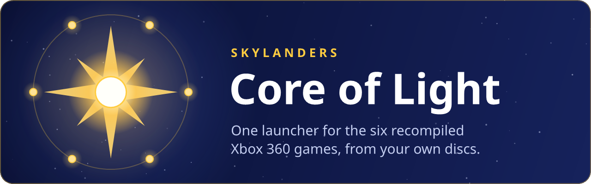
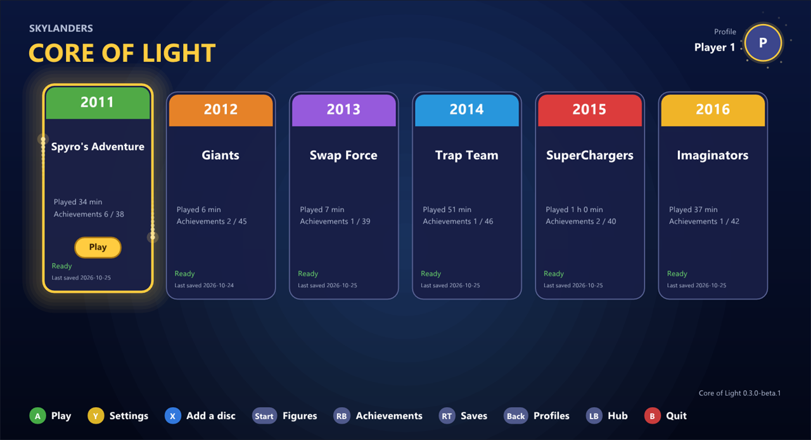
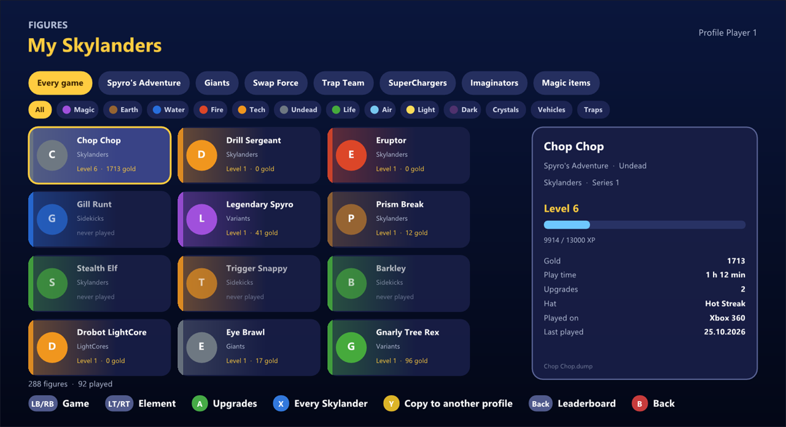
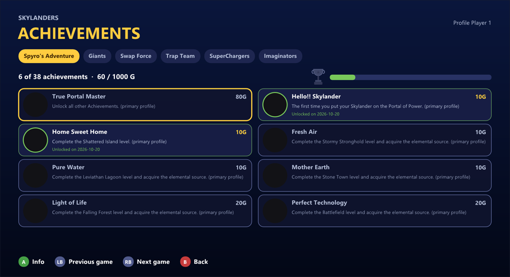
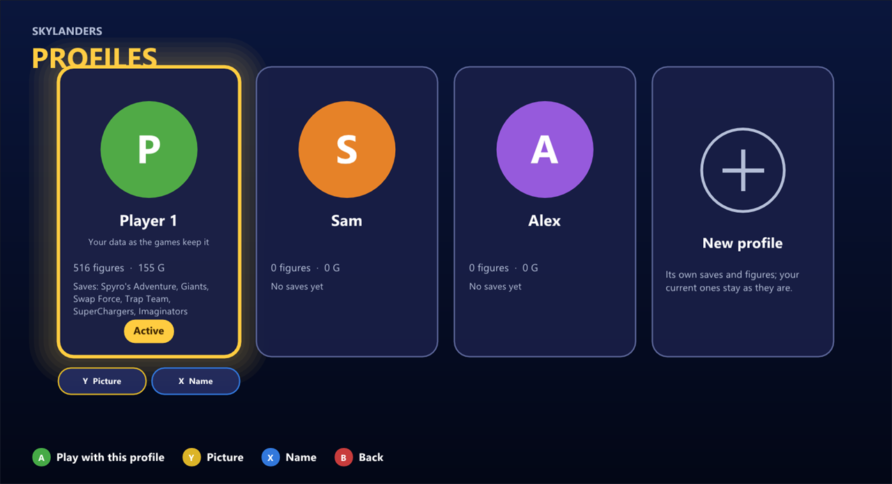
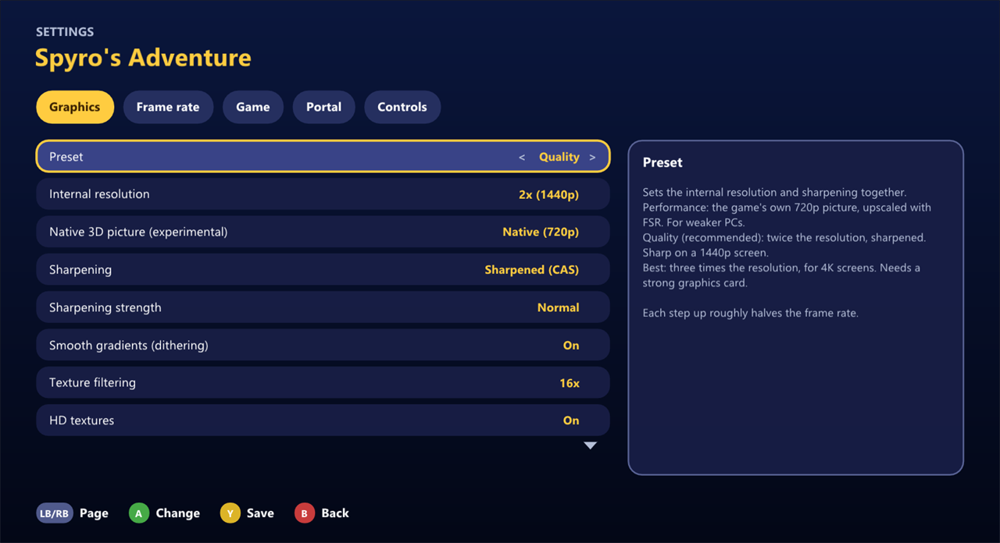
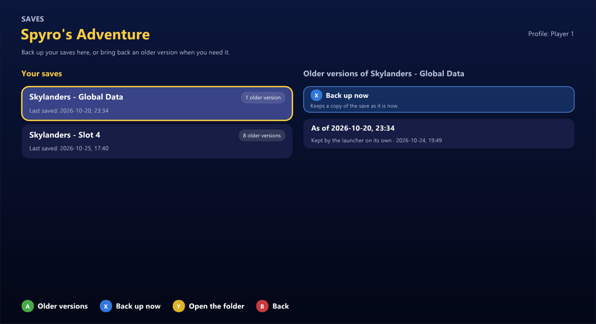

<div align="center">



<p>
For Spyro's Adventure, Giants, Swap Force, Trap Team, SuperChargers and Imaginators.<br>
Native Windows ports, no emulator, made for a controller.
</p>

<p>
<a href="https://github.com/tsapZ/SkylandersCoreOfLight/releases"></a>
</p>

<p>
<sub><a href="#screenshots">Screenshots</a> · <a href="#getting-started">Getting started</a> · <a href="#the-six-games">The games</a> · <a href="#controls">Controls</a> · <a href="#help">Help</a> · <a href="https://github.com/tsapZ/SkylandersCoreOfLight/issues/new/choose">Report a problem</a></sub>
</p>

</div>

<br>

**One launcher for the six recompiled Xbox 360 Skylanders games. It sets them up from your own
discs, keeps them up to date and holds your figures, saves and achievements in one place.**

It's made for a controller, like a console's dashboard: pick a game, press **A**, and when the game
asks for a Skylander, the portal menu opens by itself.

> Unofficial fan project. Not affiliated with or endorsed by Activision, Toys for Bob or Vicarious
> Visions. It ships no game data and no artwork: the pictures, texts and music it shows come from
> your own discs.

<br>

## Screenshots



<table>
<tr>
<td width="33%"></td>
<td width="33%"></td>
<td width="33%"></td>
</tr>
<tr>
<td align="center"><sub>Every figure, by game and element</sub></td>
<td align="center"><sub>The achievements of all six</sub></td>
<td align="center"><sub>Profiles</sub></td>
</tr>
<tr>
<td width="33%"></td>
<td width="33%"></td>
<td width="33%"></td>
</tr>
<tr>
<td align="center"><sub>A game's settings, before you start it</sub></td>
<td align="center"><sub>Saves and their older versions</sub></td>
<td></td>
</tr>
</table>

<sub>The games' own artwork is left out of these pictures (the launcher's `--no_game_art`), so the
cards, figures and achievements show plain placeholders. With your discs set up, each card has the
game's logo and background, and every figure, hat and achievement its picture.</sub>

<br>

## Getting started

1. Download `CoreOfLightSetup-<version>.exe` from the [Releases](https://github.com/tsapZ/SkylandersCoreOfLight/releases)
   page and run it. It's about 3 MB and needs no admin rights.
2. Start Core of Light. On the first start it asks for your language, then for your discs as ISO
   files (one per game; it finds the others in the same folder by itself). It says how much room
   each game needs, then downloads and installs them one after the other.
3. Pick a game and press **A**.

What you need:

- Windows 10 or 11 (64-bit) and a graphics card with DirectX 12
- your own Xbox 360 discs of the games, as ISOs or extracted folders; each game's page says which
  disc it runs
- a controller (Xbox or compatible); keyboard and mouse work too. A real Portal of Power is optional.

The setup isn't signed, so Windows may say "Windows protected your PC": click **More info**, then
**Run anyway**.

**No setup wanted?** Each release also has `CoreOfLightPortable-<version>.zip`: unzip it anywhere
and run `coreoflight.exe`. It updates itself from the next release's ZIP (keep `portable.txt` next
to the exe), so launcher managers like Quiver can handle it too.

Uninstalling goes through Windows' Apps list; it asks whether the games, your saves and your
figures should go too.

<br>

## The six games

| Game | Page | How far it is |
|---|---|---|
| **Spyro's Adventure** (2011) | [SSARecomp](https://github.com/tsapZ/SSARecomp) | Chapter 1, played a lot |
| **Giants** (2012) | [GiantsRecomp](https://github.com/tsapZ/GiantsRecomp) | the intro and Chapter 1; real 5.1 sound |
| **Swap Force** (2013) | [SwapForceRecomp](https://github.com/tsapZ/SwapForceRecomp) | the tutorial and Woodburrow; swappers, real USB portals |
| **Trap Team** (2014) | [TrapTeamRecomp](https://github.com/tsapZ/TrapTeamRecomp) | Chapter 1 and the Academy, with traps and villains |
| **SuperChargers** (2015) | [SuperChargersRecomp](https://github.com/tsapZ/SuperChargersRecomp) | the first level and the ship; both European discs |
| **Imaginators** (2016) | [ImaginatorsRecomp](https://github.com/tsapZ/ImaginatorsRecomp) | the first level; English, German or French from your PS3 disc |

None of them has been played to the end yet. Each one runs on its own as well; the launcher just
makes it easier. Every level of each game gets loaded and played by an automatic test: the
[test status](TESTING.md) shows how the last runs went.

All six share one portal and one settings menu:

- **60 FPS and more**, and **2x or 3x the console's resolution** with sharpening
- **ultrawide**
- **no portal needed:** a menu with every figure opens when the game asks; or a **real USB portal**

<br>

## What the launcher does

### Your discs in, six games out

Show it your ISOs once and it does the rest: checks each disc, unpacks it and installs the game,
on any drive you like. **Y** in its file browser finds the ISOs on your PC by itself. When a game
has a new version, its card says so; *Update all* does every game in one go, and the launcher
updates itself too. Saves, figures and settings stay.

### One shelf for every figure

Your figures live in one folder, shared by all six games like real figures next to the portal. The
**figure library** shows every one you have, by game, with its level, gold, hat, upgrade tree and
nickname. Mark the ones on your real shelf with "I own it"; there's a leaderboard too.

### Like a console's dashboard

**Profiles** work like Xbox accounts: each has its own saves, figures and achievements, and the
games show its name. **Achievements** of every game sit in one list, with a platinum one when a
game is done. While you play, the launcher hides and takes no input, so the controller only drives
the game.

### Everything else

- **Saves with backups:** each save's earlier versions, and putting one back.
- **Moving to a new PC:** *Export my data* puts all your saves, figures and settings into one ZIP,
  *Import my data* takes it back without overwriting anything.
- **Each game's settings** before you start it, the same pages as the game's own menu.
- **The title music** of the chosen game, straight from its disc.
- **Imaginators in English, German or French** from your PS3 disc (the European 360 disc only has
  Spanish and Italian).
- **Controller, keyboard or mouse:** the button hints at the bottom follow what you use, and can be
  clicked.

Everything in detail: [docs/launcher.md](docs/launcher.md).

<br>

## Controls

| | Controller | Keyboard |
|---|---|---|
| Play the chosen game | A | Enter |
| The game's settings | Y | Tab |
| Set up a disc | X | D |
| Saves and backups | RT | S |
| Achievements | RB | E |
| Figure library | Start | F |
| Profiles | Back | P |
| The launcher's settings | LB | Q |

## Your data

Everything that's yours is in `Documents\Skylanders` (or wherever you move it in the settings):
the figures in `Figures`, shared by all six games, and one folder per game with its saves and
achievements.

<br>

## Help

**A disc isn't accepted.** Each game is made for one version of its disc; its page says which. If
you have another one, open an issue on that game's page.

**Something crashed or looks wrong.** The launcher's settings (LB) > *Report a problem* writes one
text file to your desktop with the latest logs and settings of every game, your Windows user name
taken out. Open an [issue](https://github.com/tsapZ/SkylandersCoreOfLight/issues/new/choose) and
drag that file in. After a crash the launcher offers it by itself.

**Does it run on Linux?** The launcher works under Wine / Proton; the games are mainly tested on Windows.

**Why do the screenshots look so plain?** The games' artwork belongs to Activision, so the
pictures here leave it out. The banner at the top is our own drawing.

<br>

## Planned

| Part | Issues |
|---|---|
| HD textures made on your own PC: the launcher upscales a game's textures, can be stopped and picked up again, says how much room they take | [SwapForceRecomp#62](https://github.com/tsapZ/SwapForceRecomp/issues/62) |
| Online co-op, PC to PC with each player's own figures (proposal) | #1, #2, #3, [docs/online-coop.md](docs/online-coop.md) |

The order and what is next: [docs/roadmap.md](docs/roadmap.md).

<br>

## Why this exists

I wanted to play the Xbox 360 Skylanders games on my PC with just a controller, no emulator, and
with a nicer picture. That's really all it is: a private fan project. It's public in case someone
else wants the same.

## How it was made

To be upfront about it: almost all of the code here was written by [Claude](https://claude.ai) in
Claude Code, the recompile setup, the fixes, the portal menu, the launcher and the installers, and
most of the docs too. I decided what to build, said what was broken and played the games a lot. If
AI-made projects aren't your thing, that's fair.

## Principles

- **Every game stays playable without the launcher.** It starts a game's own exe and writes its
  ordinary settings file; no game depends on it.
- **No game data and no original artwork.** You point it at your own discs; pictures and texts come
  from those files at run time.
- **Shared code lives in the shared libraries:** the portal, the menus and the figure decoding in
  [`tsapZ/skylanders-portal`](https://github.com/tsapZ/skylanders-portal) (branch
  `feature/portal-menu`), the recompilation runtime in
  [`tsapZ/rexglue-sdk`](https://github.com/tsapZ/rexglue-sdk) (branch `skylanders`).

<br>

## For developers

Windows, Visual Studio 2022 (C++), CMake and Ninja, from the **x64 Native Tools Command Prompt**:

```
git clone --recursive https://github.com/tsapZ/SkylandersCoreOfLight.git
cd SkylandersCoreOfLight
cmake --preset release
cmake --build --preset release
```

The pictures at the top of this page are drawn by `tools/make_banner.ps1`, the icon by
`tools/make_icon.ps1`.

## Credits

- **[skylanders-portal](https://github.com/TheBiemGamer/skylanders-portal)** by TheBiemGamer: the
  portal library the launcher shares with the games (figure catalog and figure files), here in a
  fork with the shared menus on top. Submodule; keeps its own license.
- **[Dear ImGui](https://github.com/ocornut/imgui)** by Omar Cornut draws the launcher. Submodule
  (MIT).
- **[stb_image](https://github.com/nothings/stb)** by Sean Barrett: its zlib decoder unpacks
  Imaginators' archives for the language import, in `thirdparty/stb` (public domain / MIT).
- **[Noto Sans](https://github.com/notofonts/latin-greek-cyrillic)** by the Noto Project Authors, the
  font where Windows' Segoe UI isn't there (Wine / Proton) and on the pictures at the top, in
  `fonts/` (SIL Open Font License, `fonts/OFL.txt`).
- Figure save-data decoding builds on public reverse-engineering of the Skylanders NFC format,
  among others **[SkyReader](https://github.com/reedstrm/SkyReader)**.
- Reading the Xbox discs follows the XDVDFS format as [extract-xiso](https://github.com/XboxDev/extract-xiso)
  and [Xenia](https://xenia.jp) read it.

## License

MIT, see [LICENSE](LICENSE). Skylanders is a trademark of Activision; this project is not
affiliated with or endorsed by Activision, and it ships no game data.
