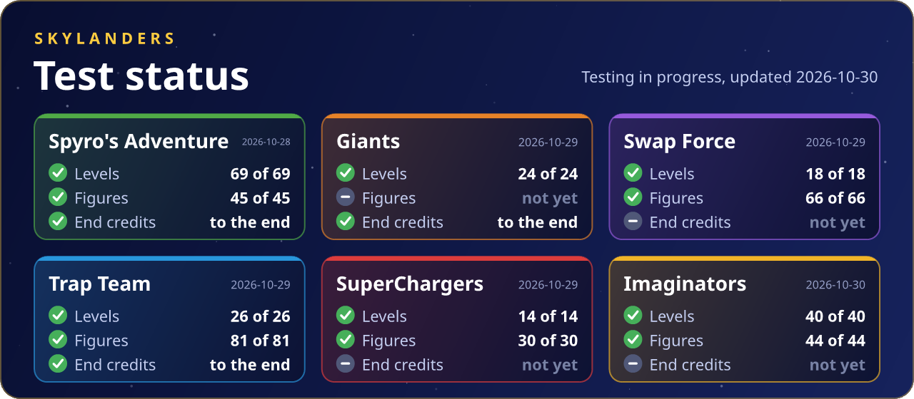

# Test status

Each game gets played automatically, on its own and from copies of real saves. It loads every level and plays it for a while, puts every Skylander and magic item on the portal as a brand new figure, and plays the end credits to the end. Crashes, script errors, missing files and the frame rate go into a report. This page shows how the last runs ended.

It doesn't replace playing: quests, bosses and two players still need people. [Report a problem](https://github.com/tsapZ/SkylandersCoreOfLight/issues/new/choose) if you find one.

| Game | Tested build | Levels | Figures | End credits |
|---|---|---|---|---|
| Spyro's Adventure | 0.3.0-beta.3+ (2026-10-28) | **69 of 69** | **45 of 45** | to the end |
| Giants | 0.3.0-beta.6 (2026-10-29) | **24 of 24** | not yet | to the end |
| Swap Force | 0.3.0-beta.6 (2026-10-29) | **18 of 18** | **66 of 66** | not yet |
| Trap Team | 0.3.0-beta.6 (2026-10-29) | **26 of 26** | **81 of 81** | to the end |
| SuperChargers | 0.3.0-beta.6 (2026-10-29) | **14 of 14** | **30 of 30** | not yet |
| Imaginators | 0.3.0-beta.6 (2026-10-30) | **40 of 40** | **44 of 44** | not yet |

## Spyro's Adventure

Tested build: 0.3.0-beta.3+ (2026-10-28)

| What | Result |
|---|---|
| Story levels | 27 of 27 loaded and played |
| The Ruins (hub) | 1 of 1 loaded and played |
| Heroic Challenges | 32 of 32 loaded and played |
| Arenas | 9 of 9 loaded and played |
| Lowest frame rate in a level | 36 FPS |
| Skylanders, each as a new figure | 32 of 32 |
| Variants, each as a new figure | 5 of 5 |
| Magic items, each as a new figure | 8 of 8 |
| End credits | played to the end |

Found on the way:

- Oilspill Island crashed while it loaded ([#42](https://github.com/tsapZ/SSARecomp/issues/42)): fixed in 0.3.0-beta.3. Every level loads now.
- Two of the game's own scripts slip (one asks for something that isn't there). The game catches both and plays on, as it does on the console.

## Giants

Tested build: 0.3.0-beta.6 (2026-10-29)

| What | Result |
|---|---|
| Levels | 24 of 24 loaded and played |
| Lowest frame rate in a level | 59 FPS |
| End credits | played to the end |

Found on the way:

- In the first run of all the story levels, one hub stage crashed while loading, as the 23rd level in a row. The test itself had caused that (it's fixed); the second run loaded all 24 without a problem.

## Swap Force

Tested build: 0.3.0-beta.6 (2026-10-29)

| What | Result |
|---|---|
| Levels | 18 of 18 loaded and played |
| Lowest frame rate in a level | 56 FPS |
| Skylanders, each as a new figure | 32 of 32 |
| Swappers, each as a new figure | 16 of 16 |
| LightCore Skylanders, each as a new figure | 8 of 8 |
| Variants, each as a new figure | 10 of 10 |

## Trap Team

Tested build: 0.3.0-beta.6 (2026-10-29)

| What | Result |
|---|---|
| Levels | 26 of 26 loaded and played |
| Lowest frame rate in a level | 59 FPS |
| Skylanders, each as a new figure | 23 of 23 |
| Trap Masters, each as a new figure | 18 of 18 |
| Eon's Elite, each as a new figure | 8 of 8 |
| Minis, each as a new figure | 16 of 16 |
| Variants, each as a new figure | 16 of 16 |
| End credits | played to the end |

## SuperChargers

Tested build: 0.3.0-beta.6 (2026-10-29)

| What | Result |
|---|---|
| Levels | 14 of 14 loaded and played |
| Lowest frame rate in a level | 57 FPS |
| SuperChargers, each as a new figure | 18 of 18 |
| Variants, each as a new figure | 12 of 12 |

Found on the way:

- The test also tried a few zones the game lists but never sends you to on its own (one without its map on the disc, and the elemental gates' areas, which belong to a level). Asked for alone, they end the game. A player can't get there, so they aren't counted here.
- Donkey Kong and Bowser (and their Dark versions) came with the Wii U and 3DS games only; the Xbox 360 game doesn't take them, so the figure test leaves them out.

## Imaginators

Tested build: 0.3.0-beta.6 (2026-10-30)

| What | Result |
|---|---|
| Levels | 40 of 40 loaded and played |
| Lowest frame rate in a level | 53 FPS |
| Senseis, each on the portal | 20 of 20 |
| Villain Senseis, each on the portal | 11 of 11 |
| Sensei variants, each on the portal | 7 of 7 |
| Villain variants, each on the portal | 6 of 6 |

Found on the way:

- Imaginators turns down a figure its toy maker didn't make, so a blank one made by the test can't go on. Its figures were tested with the files of real figures instead.
